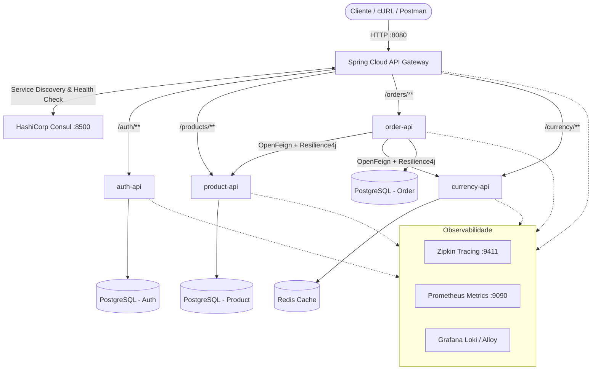

# microservices-java


> Arquitetura de microsserviços back-end desacoplada, resiliente e observável para o domínio de e-commerce, construída com **Java 21**, **Spring Boot 3** e orquestrada integralmente via **Docker Compose**.

---

## Índice

- [Visão Geral](#-visão-geral)
- [Arquitetura do Sistema](#-arquitetura-do-sistema)
- [Microsserviços e Infraestrutura](#-microsserviços-e-infraestrutura)
- [Padrões Arquiteturais Aplicados](#-padrões-arquiteturais-aplicados)
- [Pré-requisitos](#-pré-requisitos)
- [Como Executar](#-como-executar)
- [Fluxo de Autenticação e Endpoints](#-fluxo-de-autenticação-e-endpoints)
- [Observabilidade e Monitoramento](#-observabilidade-e-monitoramento)
- [Estrutura do Repositório](#-estrutura-do-repositório)
- [Licença](#-licença)

---

## Visão Geral

Este projeto implementa um ecossistema distribuído back-end seguindo os princípios da metodologia **Twelve-Factor App**. Em vez de uma base monolítica acoplada, cada domínio de negócio opera de forma autônoma, com persistência exclusiva, registro dinâmico de instâncias, roteamento centralizado, segurança *stateless* via JWT e rastreamento distribuído ponta a ponta.

---

## Arquitetura do Sistema



---

## Microsserviços e Infraestrutura

| Serviço / Componente | Responsabilidade | Persistência / Tecnologia | Porta Padrão |
| :--- | :--- | :--- | :--- |
| **`api-gateway`** | Ponto único de entrada (*Single Entry Point*), validação de tokens JWT e roteamento dinâmico | Spring Cloud Gateway | `8080` |
| **`auth-api`** | Gestão de usuários, credenciais e emissão de tokens JWT (RFC 7519) | PostgreSQL + Flyway | Dinâmica (via Consul) |
| **`product-api`** | Catálogo de produtos, categorias e controle de estoque | PostgreSQL + Flyway | Dinâmica (via Consul) |
| **`order-api`** | Processamento de pedidos, validação de estoque e conversão de valores | PostgreSQL + Flyway | Dinâmica (via Consul) |
| **`currency-api`** | Cotações e conversões monetárias em tempo real | Redis (Cache em memória) | Dinâmica (via Consul) |
| **`consul`** | Registro e descoberta dinâmica de serviços (*Service Discovery*) | HashiCorp Consul | `8500` |
| **`zipkin`** | Rastreamento distribuído de requisições (*Distributed Tracing*) | Micrometer Tracing + Zipkin | `9411` |
| **`prometheus`** | Coleta de métricas de saúde e desempenho (`/actuator/prometheus`) | Prometheus | `9090` |
| **`loki` & `alloy`** | Agregação e consulta centralizada de logs dos containers | Grafana Loki + Grafana Alloy | `3100` |

---

## Padrões Arquiteturais Aplicados

- **Database per Service:** Isolamento total da camada de dados; nenhum microsserviço acessa diretamente o banco de outro domínio.
- **Migrations Automatizadas:** Versionamento de esquema relacional controlado pelo **Flyway** na inicialização de cada API.
- **Client-Side Load Balancing & Service Discovery:** Registro automático no **HashiCorp Consul** com *Health Checks* ativos.
- **Resiliência e Tolerância a Falhas:** Comunicação síncrona via **Spring Cloud OpenFeign** protegida por *Circuit Breakers* e *Fallbacks* com **Resilience4j**.
- **Segurança Stateless (JWT):** Validação centralizada no Gateway com propagação segura de contexto (`X-User-Id`, `X-User-Roles`) para os serviços internos.
- **Tratamento Padronizado de Erros:** Exceções mapeadas globalmente via `@ControllerAdvice` seguindo a especificação **RFC 7807 (Problem Details)**.
- **Multi-Stage Docker Builds:** Imagens enxutas baseadas em `OpenJDK 21 JRE` para otimização de memória e tempo de subida.

---

## Pré-requisitos

Certifique-se de ter instalados em sua máquina:

- [Docker](https://docs.docker.com/get-docker/) (`v24+`)
- [Docker Compose](https://docs.docker.com/compose/) (`v2.20+`)
- [Git](https://git-scm.com/)
- *(Opcional, para build local)* Java 21 (JDK) e Maven 3.9+

---

## Como Executar

1. **Clone o repositório:**
   ```bash
   git clone [https://github.com/jubraccini/microservices-java.git](https://github.com/jubraccini/microservices-java.git)
   cd microservices-java
   ```

2. **Suba toda a infraestrutura e os microsserviços:**
   ```bash
   docker compose up --build -d
   ```

3. **Acompanhe a inicialização e os Health Checks:**
   ```bash
   docker compose ps
   ```
   Aguarde cerca de 30–45 segundos até que todas as APIs concluam as migrações do Flyway e apareçam como saudáveis (`passing`) no painel do Consul em `http://localhost:8500`.


4. **Para encerrar e remover os containers:**
   ```bash
   docker compose down -v
   ```

---

## Fluxo de Autenticação e Endpoints

Todas as requisições externas devem passar exclusivamente pelo **API Gateway (`http://localhost:8080`)**.

### 1. Registrar um novo usuário (`auth-api`)
```bash
curl -X POST http://localhost:8080/auth/register \
  -H "Content-Type: application/json" \
  -d '{
    "name": "Julia Braccini",
    "email": "julia@exemplo.com",
    "password": "SenhaForte@123"
  }'
```

### 2. Autenticar e obter o Token JWT (`auth-api`)
```bash
curl -X POST http://localhost:8080/auth/login \
  -H "Content-Type: application/json" \
  -d '{
    "email": "julia@exemplo.com",
    "password": "SenhaForte@123"
  }'
```

### 3. Consultar produtos autenticados (`product-api`)
```bash
curl -X GET http://localhost:8080/products \
  -H "Authorization: Bearer <SEU_TOKEN_JWT>"
```

### 4. Criar pedido com conversão cambial (`order-api` $\rightarrow$ `product-api` + `currency-api`)
```bash
curl -X POST http://localhost:8080/orders \
  -H "Content-Type: application/json" \
  -H "Authorization: Bearer <SEU_TOKEN_JWT>" \
  -d '{
    "items": [
      { "productId": 1, "quantity": 2 }
    ],
    "targetCurrency": "BRL"
  }'
```

---

## Observabilidade e Monitoramento

Após subir o ambiente, acesse os painéis de telemetria localmente:

- **HashiCorp Consul (Service Registry):** [http://localhost:8500](http://localhost:8500)
- **Zipkin (Distributed Tracing):** [http://localhost:9411](http://localhost:9411)
- **Prometheus (Métricas):** [http://localhost:9090](http://localhost:9090)

---

## Estrutura do Repositório

```text
├── api-gateway/          # Roteamento, filtros JWT e integração com Consul
├── auth-api/             # Autenticação, emissão de tokens e gestão de usuários
├── currency-api/         # Conversão monetária e cache distribuído com Redis
├── order-api/            # Orquestração de pedidos via OpenFeign + Resilience4j
├── product-api/          # Catálogo de produtos e controle de estoque
├── observability/        # Configurações de Prometheus, Loki e Grafana Alloy
└── docker-compose.yml    # Orquestração completa da rede, bancos e serviços
```

---

## Licença

Este projeto está sob a licença **MIT**. Consulte o arquivo [LICENSE](LICENSE) para obter mais detalhes.

---

Desenvolvido por **Julia Braccini** — Ciência da Computação (Atitus Educação).
