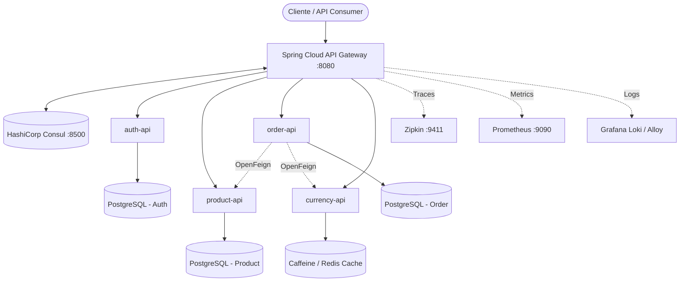

# Microservices E-Commerce Back-End


Arquitetura de microsserviços distribuídos voltada para o domínio de e-commerce, desenvolvida com **Java 21** e **Spring Boot 3**. O ecossistema aplica boas práticas de sistemas distribuídos, incluindo roteamento dinâmico via API Gateway, registro e descoberta de serviços com HashiCorp Consul, isolamento de persistência (*Database per Service*), autenticação stateless com JWT, resiliência com Resilience4j e observabilidade centralizada.

---

## Arquitetura do Sistema



---

## Microsserviços e Componentes

| Serviço / Componente | Responsabilidade | Tecnologias Principais |
| :--- | :--- | :--- |
| **`api-gateway`** | Ponto único de entrada, roteamento dinâmico, validação de JWT e propagação de contexto (`X-User-*`) | Spring Cloud Gateway, JWT |
| **`auth-api`** | Cadastro de usuários, autenticação e emissão de tokens JWT | Spring Security, PostgreSQL, Flyway |
| **`product-api`** | Gestão de catálogo de produtos, paginação e controle de acesso administrativo | Spring Data JPA, PostgreSQL, Flyway |
| **`order-api`** | Processamento de pedidos, comunicação síncrona entre serviços e conversão cambial | Spring Cloud OpenFeign, PostgreSQL |
| **`currency-api`** | Conversão monetária e consulta de cotações em tempo real (BCB) com cache e fallback | Resilience4j, Caffeine, OpenFeign |
| **Service Discovery** | Registro automático de instâncias e monitoramento de Health Checks | HashiCorp Consul |
| **Observabilidade** | Rastreamento distribuído, coleta de métricas e agregação de logs | Zipkin, Prometheus, Grafana Loki & Alloy |

---

## Como Executar o Projeto

### Pré-requisitos
- **Docker** e **Docker Compose** instalados
- **Java 21** e **Maven** (opcional, caso deseje compilar localmente fora dos containers)

### Passo a Passo

1. **Clone o repositório:**
   ```bash
   git clone [https://github.com/jubraccini/microservices-java.git](https://github.com/jubraccini/microservices-java.git)
   cd microservices-java
   ```

2. **Suba toda a infraestrutura e os microsserviços:**
   ```bash
   docker compose up -d --build
   ```

3. **Aguarde a inicialização:**
   Todos os serviços se registrarão automaticamente no Consul. Você pode acompanhar o status dos containers com:
   ```bash
   docker compose ps
   ```

---

## Endpoints da API

Todas as requisições externas entram pelo **API Gateway (`http://localhost:8080`)**.  
Rotas sob `/ws/**` exigem `Authorization: Bearer <token>`, através do qual o Gateway valida o JWT e propaga os metadados do usuário (`X-User-Id`, `X-User-Email`, `X-User-Type`).

| Serviço | Método | Rota | Autenticação | Descrição |
| :--- | :--- | :--- | :--- | :--- |
| **`auth-api`** | `POST` | `/auth/signup` | Pública | Cadastra um novo usuário (`Common`) |
| **`auth-api`** | `POST` | `/auth/signin` | Pública | Autentica o usuário e retorna o Token JWT |
| **`product-api`** | `GET` | `/products` | Pública | Lista produtos paginados (`?page=0&size=10`) |
| **`product-api`** | `GET` | `/products/{id}` | Pública | Busca detalhes de um produto pelo ID |
| **`product-api`** | `POST` | `/ws/products` | JWT (`Admin` / Type `0`) | Cadastra um novo produto no catálogo |
| **`currency-api`** | `GET` | `/currency-service/{number}/{from}/{to}` | Pública | Converte valores via cotação do BCB (`?date=MM-dd-yyyy` opcional) |
| **`order-api`** | `POST` | `/ws/orders` | JWT (Autenticado) | Cria um pedido buscando preços via Feign no `product-api` |
| **`order-api`** | `GET` | `/ws/orders?targetCurrency=BRL` | JWT (Autenticado) | Lista pedidos do usuário com conversão cambial |

### Exemplos Rápidos (`cURL`)

```bash
# 1. Autenticar e obter o Token JWT
curl -X POST http://localhost:8080/auth/signin \
  -H "Content-Type: application/json" \
  -d '{"email": "julia@exemplo.com", "password": "SenhaForte@123"}'

# 2. Listar catálogo de produtos
curl -X GET "http://localhost:8080/products?page=0&size=10"

# 3. Criar um novo pedido (substitua pelo token JWT obtido no login)
curl -X POST http://localhost:8080/ws/orders \
  -H "Content-Type: application/json" \
  -H "Authorization: Bearer <SEU_TOKEN_JWT>" \
  -d '{"items": [{"productId": 1, "quantity": 2}]}'
```

---

## Observabilidade e Monitoramento

Com os containers em execução, os painéis de acompanhamento ficam disponíveis nos seguintes endereços:

- **HashiCorp Consul (Service Discovery):** http://localhost:8500
- **Zipkin (Distributed Tracing):** http://localhost:9411
- **Prometheus (Métricas):** http://localhost:9090

---

## Boas Práticas Aplicadas

- **Database per Service:** Bancos isolados por domínio, evitando acoplamento na camada de dados.
- **Resiliência:** Uso de Circuit Breaker e Fallbacks no consumo de cotações externas.
- **Tratamento Padronizado de Erros:** Exceções mapeadas globalmente via `@ControllerAdvice` (RFC 7807).
- **Multi-stage Docker Builds:** Imagens enxutas baseadas em OpenJDK 21 JRE.

---

## Licença

Este projeto está sob a licença **MIT**. Consulte o arquivo [LICENSE](LICENSE) para mais detalhes.

---

Desenvolvido por **Julia Braccini** — Ciência da Computação (Atitus Educação).
